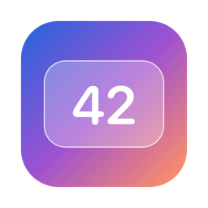
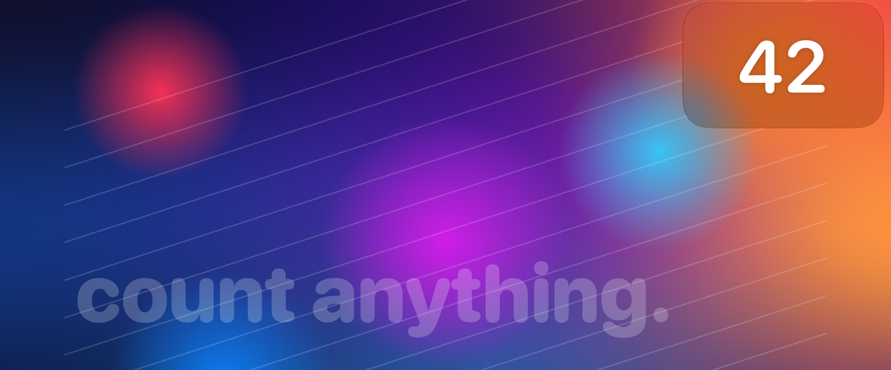
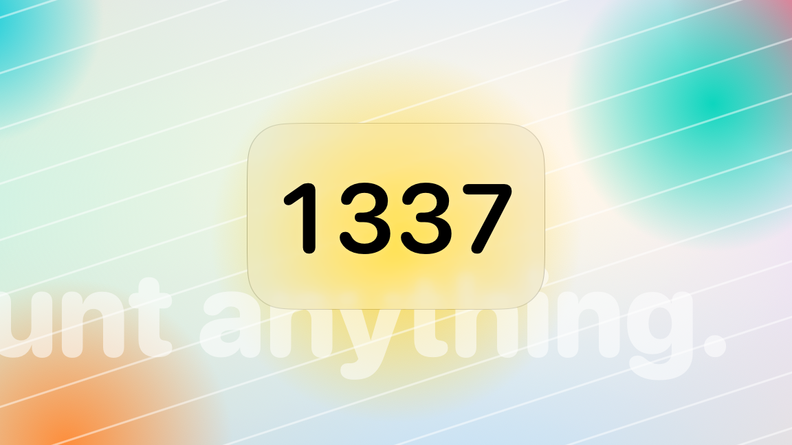
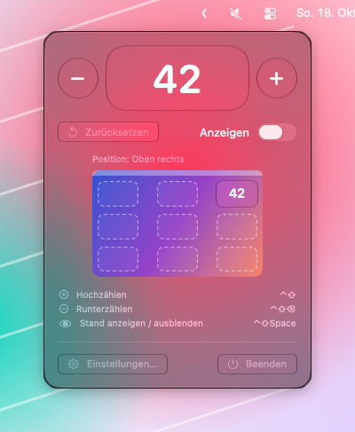
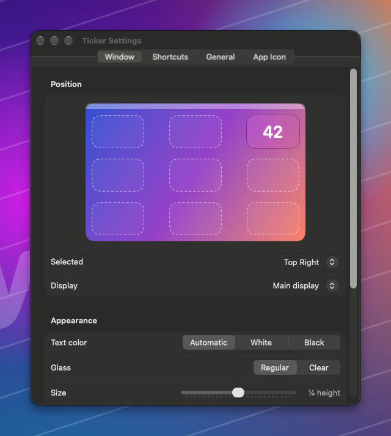

<div align="center">



# Ticker

[English](README.md) · Lizenz: [MIT](LICENSE)



</div>

Ein schlanker Zähler für macOS 26+ (Tahoe und neuer), der in der **Menüleiste** lebt und den aktuellen Stand in einem großen, schwebenden **Liquid-Glass**-Fenster anzeigt. Hoch- und runtergezählt wird über **globale Tastenkürzel**, die in jeder App funktionieren.

## Funktionen

- **Nur Menüleiste**: kein Dock-Icon. Das Menüleisten-Symbol zeigt den Zählerstand und öffnet ein Panel mit −/+ und Zurücksetzen, einem Positionswähler, einer Kürzelübersicht und dem Weg zu den Einstellungen.
- **Echtes Liquid Glass**: Das Overlay nutzt Apples `NSGlassEffectView` (AppKit, macOS 26). Der Hintergrund ist also das System-Material selbst, kein Nachbau: verschwommen, mit den typischen Lichtkanten. Stil *Regular* oder *Clear* ist wählbar.
- **Position**: 9 Plätze (die vier Ecken, die Mitte jeder Kante und die Bildschirmmitte), auswählbar auf einer Mini-Bildschirm-Vorschau. Standard ist **oben rechts**.
- **Größe**: standardmäßig **¼ der Bildschirmhöhe**. Skalierung, Seitenverhältnis (Standard 1,6 : 1) und Randabstand lassen sich einstellen.
- **Textfarbe**: Weiß, Schwarz oder *Automatisch*. *Automatisch* misst die Helligkeit des Hintergrundbilds hinter dem Fenster und passt Text und Glas-Erscheinung daran an.
- **Sichtbarkeit**:
  - *Bei Änderung kurz einblenden* (Standard): Das Fenster erscheint beim Zählen für eine einstellbare Dauer.
  - *Immer sichtbar*
  - *Nur per Tastenkürzel*: Das „Anzeigen“-Kürzel blendet ein und aus.
- **Frei belegbare globale Kürzel** für Hochzählen, Runterzählen, Anzeigen und Zurücksetzen. Möglich sind normale Kombinationen (z. B. `⌃⇧⌫`) und **reine Modifier-Kombinationen** (z. B. nur `⌃⇧`).
- Schrittweite, Startwert, negative Werte erlauben, Klick-Ton, Zahl in der Menüleiste anzeigen, Start bei der Anmeldung.
- Animierte Zahl (`numericText`-Übergang), Zählerstand bleibt nach einem Neustart erhalten.

<table>
  <tr>
    <td width="50%"></td>
    <td width="50%"></td>
  </tr>
  <tr><td colspan="2"></td></tr>
</table>

### Standard-Kürzel

| Aktion | Kürzel |
|---|---|
| Hochzählen | `⌃⇧` (Control + Shift gemeinsam drücken und loslassen) |
| Runterzählen | `⌃⇧⌫` |
| Stand anzeigen / ausblenden | `⌃⇧Space` |
| Zurücksetzen | – (frei belegbar) |

> **Berechtigung:** Reine Modifier-Kürzel wie `⌃⇧` brauchen den Zugriff unter **Systemeinstellungen → Datenschutz & Sicherheit → Bedienungshilfen**. Ticker fragt beim ersten Start danach. Normale Kombinationen funktionieren ohne Berechtigung.

## Installieren (empfohlen)

Voraussetzungen: macOS 26 oder neuer und Xcode 26 oder neuer (Swift 6.2+).

```bash
git clone https://github.com/jonaslpeuu/ticker.git
cd ticker
scripts/install.sh
```

Das Skript baut die Release-Version, installiert sie nach **`/Applications/Ticker.app`** und startet sie. Beim ersten Start aus `/Applications` trägt sich Ticker automatisch als **Anmeldeobjekt** ein und läuft ab dann nach jedem Hochfahren. Abschalten lässt sich das unter Einstellungen → Zähler → „Bei Anmeldung starten“ oder in den Systemeinstellungen unter Allgemein → Anmeldeobjekte.

Signiert wird mit dem ersten gefundenen „Apple Development“-Zertifikat. So bleibt die Bedienungshilfen-Freigabe auch nach Updates erhalten. Ein anderes Zertifikat lässt sich mit `TICKER_SIGN_IDENTITY` festlegen, `-` steht für ad hoc. Für ein Update einfach `scripts/install.sh` erneut ausführen.

## Bauen für die Entwicklung

```bash
scripts/build-app.sh release --run
```

Das Skript erzeugt `dist/Ticker.app` und startet sie. Diese Kopie trägt sich nicht als Anmeldeobjekt ein, das passiert nur bei Installation nach `/Applications`.

Nur kompilieren:

```bash
swift build --scratch-path ~/Library/Caches/Ticker-build
```

> Die Build-Produkte liegen bewusst **außerhalb** des Repos (`~/Library/Caches/Ticker-build`): Enthält der Repo-Pfad Leerzeichen oder Anführungszeichen, scheitert sonst der Linker von SwiftPM.

Screenshots für die README neu erzeugen (Demo-Modus mit Beispiel-Hintergrund, braucht die Bildschirmaufnahme-Berechtigung):

```bash
scripts/screenshots.sh
```

Das App-Icon neu erzeugen:

```bash
swift scripts/make-icon.swift
```

## Bedienung

1. Auf die Zahl in der Menüleiste klicken. Dort gibt es −/+, Zurücksetzen, „Fenster anzeigen“ und die Position.
2. **Einstellungen…** (`⌘,` im Panel) hat drei Tabs:
   - **Fenster**: Position, Bildschirm, Textfarbe, Glas-Stil, Größe, Seitenverhältnis, Randabstand, Sichtbarkeit.
   - **Tastenkürzel**: Auf ein Kürzel klicken und die neue Kombination drücken. Für reine Modifier-Kürzel die Tasten zusammen drücken und loslassen. `Esc` bricht ab, `ⓧ` entfernt das Kürzel.
   - **Zähler**: Stand direkt setzen, Schrittweite, Startwert, negative Werte, Ton, Menüleistenanzeige, Autostart.

## Bekannte Grenzen

- *Automatische Textfarbe* wertet nur das **Hintergrundbild** aus, keine Fenster darüber, denn dafür wäre die Bildschirmaufnahme-Berechtigung nötig. Bei dynamischen oder Video-Hintergründen richtet sie sich nach dem Hell/Dunkel-Modus des Systems.
- Bei Ad-hoc-Signatur (`build-app.sh` ohne `TICKER_SIGN_IDENTITY`) kann macOS nach jedem Neu-Bauen den Bedienungshilfen-Zugriff „vergessen“. Dann Ticker in den Systemeinstellungen entfernen und neu hinzufügen. `install.sh` vermeidet das durch ein festes Zertifikat.
- Reine Modifier-Kürzel lösen nur aus, wenn die Tasten kürzer als 1 s gehalten wurden und dazwischen keine andere Taste oder kein Klick kam. So kollidiert `⌃⇧` nicht mit `⌃⇧⌫`.

## Mitmachen

Siehe [CONTRIBUTING.md](CONTRIBUTING.md) und [AGENTS.md](AGENTS.md). Dort stehen Architektur, Konventionen und Hinweise zur Weiterentwicklung.

## Lizenz

[MIT](LICENSE): frei nutzbar für alles, auch kommerziell.
