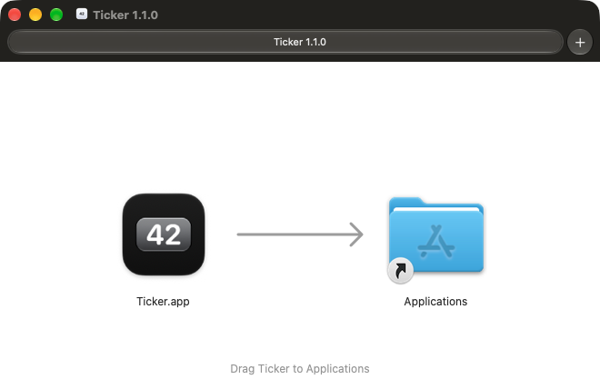

<div align="center">


# Ticker

**A tiny menu bar counter for macOS, rendered in Apple's real Liquid Glass.**

Count anything with a global shortcut, from reps and laps to cups of coffee, interruptions or tally marks. Glance at the number in a big floating glass panel.

[](#requirements)
[](https://swift.org)
[](LICENSE)

[Deutsch](README.de.md)


</div>

## Features

- **Menu bar only.** Ticker has no Dock icon. The menu bar item shows the current count and opens a small glass panel with −/+, reset, a position picker and a list of your shortcuts.
- **Real Liquid Glass.** The overlay uses Apple's own `NSGlassEffectView` (macOS 26+), not a hand-made blur. You can choose the *Regular* or *Clear* style.
- **Place it anywhere.** There are nine spots: the four corners, the middle of each edge, and the center of the screen. The default is **top right**. You can show it on the main display or on whichever display has the mouse pointer.
- **Big and readable.** By default the panel is **¼ of the screen height**. You can change its scale, aspect ratio and distance from the screen edge.
- **Text color that adapts.** Choose white, black or *Automatic*. Automatic checks how bright your wallpaper is behind the panel and switches the text color and glass appearance to match.
- **Global shortcuts you can change.** Increment, decrement, show/hide and reset all have shortcuts that work in every app. A shortcut can be a normal combo like `⌃⇧⌫` or a **modifiers-only** combo like just `⌃⇧`.
- **Three visibility modes.** The panel can flash briefly on every change (the default), stay always visible, or appear only when you press the shortcut.
- **Choose your app icon.** Pick one of four Liquid Glass icons in **Settings → App-Icon**. The default *Kachel* (tile) is rendered live by macOS in every icon style: default, dark, clear and tinted.
- Step size, start value, optional negative numbers, an optional click sound, animated number changes, launch at login, and a count that is kept between launches.

<table>
  <tr>
    <td width="50%"><br><sub><b>Automatic text color</b>: black on a light background, white on a dark one.</sub></td>
    <td width="50%"><br><sub><b>Menu bar panel</b>: count, −/+, position picker and your shortcuts.</sub></td>
  </tr>
  <tr>
    <td colspan="2"><br><sub><b>Settings</b>: position, appearance, size, visibility, shortcuts and counter options.</sub></td>
  </tr>
</table>

## Default shortcuts

| Action | Shortcut |
|---|---|
| Count up | `⌃⇧`: press Control and Shift together, then release |
| Count down | `⌃⇧⌫` |
| Show / hide the panel | `⌃⇧Space` |
| Reset | none, set your own |

Every shortcut can be changed under **Settings → Tastenkürzel**.

> **Permission:** Modifiers-only shortcuts like `⌃⇧` need **System Settings → Privacy & Security → Accessibility** turned on for Ticker. Ticker asks for this on first launch. Normal key combos work without any permission.

## Requirements

- macOS 26 Tahoe or newer
- Xcode 26 or newer (Swift 6.2) to build

## Download

1. Download **Ticker-1.1.0.dmg** from the [latest release](https://github.com/jonaslpeuu/ticker/releases/latest).
2. Open it and drag **Ticker** onto **Applications**.



3. Start Ticker from Applications. Ticker isn't notarized by Apple yet, so the first launch is blocked. Go to **System Settings → Privacy & Security** and click **Open Anyway**. You only have to do this once. Alternatively, run this in Terminal:

   ```bash
   xattr -dr com.apple.quarantine /Applications/Ticker.app
   ```

Ticker adds itself to your login items on first launch, so it starts automatically after every restart.

## Build from source

```bash
git clone https://github.com/jonaslpeuu/ticker.git
cd ticker
scripts/install.sh
```

`install.sh` builds a release version, copies it to **`/Applications/Ticker.app`** and starts it. The first time Ticker runs from `/Applications`, it adds itself to your **login items**, so it starts every time you turn on your Mac. You can turn that off in the settings.

The app is signed with the first *Apple Development* certificate in your keychain, which keeps the Accessibility permission across updates. If there is none, it is signed ad hoc. To use a different certificate, set `TICKER_SIGN_IDENTITY="<identity>"`. To update, run `scripts/install.sh` again.

## Development

```bash
scripts/build-app.sh release --run                          # build dist/Ticker.app and start it
swift build --scratch-path ~/Library/Caches/Ticker-build    # compile only
scripts/screenshots.sh                                      # regenerate docs/images (demo mode)
scripts/make-dmg.sh                                         # universal release DMG → dist/Ticker-<version>.dmg
swift scripts/make-icons.swift && scripts/render-icon-previews.sh   # regenerate the app icons
```

Build products are kept outside the repo (`~/Library/Caches/Ticker-build`) because SwiftPM's linker fails when the repo path contains spaces or quotes.

The screenshots come from Ticker's built-in **demo mode**. It places a generated sample wallpaper behind the real glass panel, so your own desktop never ends up in a picture:

```bash
dist/Ticker.app/Contents/MacOS/Ticker --demo overlay --backdrop dark -position center -counterValue 42
```

Architecture, conventions and gotchas are documented in **[AGENTS.md](AGENTS.md)**. It is written for human contributors and AI coding agents alike.

## Known limitations

- *Automatic* text color only checks your **wallpaper**, not the windows on top of it, because seeing those would need Screen Recording permission. With dynamic or video wallpapers it follows the system's light/dark mode instead.
- Modifiers-only shortcuts fire when you release the keys, and only if no other key or click happened while you held them and you held them for less than one second. That way `⌃⇧` never clashes with `⌃⇧⌫`.
- The app's interface is in German for now. Translations are welcome (see [Contributing](CONTRIBUTING.md)).

## License

[MIT](LICENSE). Use it, fork it, ship it.
